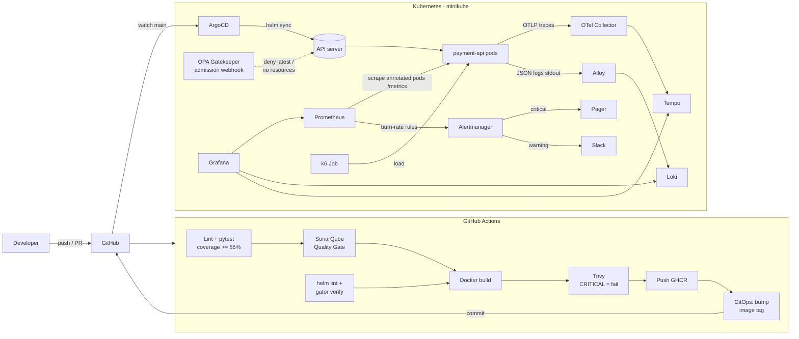

# Payment API - Continuous Delivery, Quality & Security Gates, SRE & Observability

TP DevOps/SRE: a FastAPI microservice delivered by a secured CI/CD chain (tests, SonarQube Quality Gate, Trivy,
OPA Gatekeeper, ArgoCD GitOps) and operated with SLOs, error budget and burn-rate alerting
(OpenTelemetry, Prometheus, Grafana, Loki, Tempo, Alertmanager, k6).

The SRE report is in [`docs/RAPPORT-SRE.md`](docs/RAPPORT-SRE.md).

## Architecture



## Repository layout

| Path | Content |
|---|---|
| `app/` | FastAPI service: catalog, payments, `/checkout` (slow), `/flaky` (intermittent 500), `/metrics`, OpenTelemetry, JSON logs, load shedding |
| `tests/` | pytest unit/integration tests (100 % coverage, gate at 85 %, Cobertura `coverage.xml` + `coverage.lcov`) |
| `Dockerfile` | multi-stage, non-root, pinned base image |
| `.github/workflows/ci.yml` | pipeline: lint & test -> SonarQube + Quality Gate -> build -> Trivy -> push -> GitOps |
| `sonar/` | SonarQube setup (quality profile + quality gate via API), gate report |
| `policies/` | Gatekeeper ConstraintTemplates (Rego), Constraints, test manifests, `gator` suite |
| `deploy/helm/payment-api/` | Helm chart (Deployment, Service, HPA) |
| `deploy/argocd/` | ArgoCD install values and Applications (app, policies, non-compliant demo) |
| `observability/` | Helm values of kube-prometheus-stack, Loki, Tempo, OTel Collector, Alloy; SLO rules; Grafana dashboard |
| `k6/` | load test (ramp-up 100 VU, stress 500 VU, spike 1500 VU) and in-cluster Job |
| `demo/bad-pr/` | code for the non-compliant pull request (Quality Gate demo) |
| `docs/` | SRE report, runbook, screenshots |

## API

| Endpoint | Description |
|---|---|
| `GET /api/v1/products`, `GET /api/v1/products/{id}` | product catalog |
| `POST /api/v1/payments` | payment (Luhn card check, stock, currency conversion) |
| `GET /checkout` | simulated slow processing: 20-150 ms, 2 % of requests take 900 ms |
| `GET /flaky?error_rate=0.1` | fails with HTTP 500 with the given probability |
| `GET /metrics` | Prometheus metrics (OpenTelemetry SDK + Prometheus exporter) |
| `GET /healthz`, `GET /readyz` | probes |

Every pod sheds load (HTTP 503 + `Retry-After`) above `MAX_IN_FLIGHT` concurrent requests.

## Quick start

```bash
# 1. Local development
python -m venv .venv && . .venv/bin/activate
pip install -r requirements-dev.txt
ruff check . && pytest                 # coverage report + gate at 85 %
uvicorn app.main:app --reload          # http://localhost:8000/docs

# 2. Cluster + platform (Gatekeeper, observability, ArgoCD)
minikube start -p tp2 --cpus=6 --memory=10240 --kubernetes-version=v1.31.4
minikube -p tp2 addons enable metrics-server
SLACK_WEBHOOK_URL=https://hooks.slack.com/services/... ./scripts/install-platform.sh   # Slack URL optional
./scripts/port-forward.sh              # Grafana :3000, Prometheus :9090, Alertmanager :9093, ArgoCD :8081

# 3. Policy enforcement check (must be rejected by the API server)
kubectl apply -f policies/tests/bad-latest-tag.yaml
kubectl apply -f policies/tests/bad-no-resources.yaml
kubectl apply -f deploy/argocd/noncompliant-app.yaml   # ArgoCD sync fails the same way

# 4. Load test (~14 min) - watch the "Payment API - SRE" dashboard
./scripts/run-load-test.sh             # or SCENARIO=spike ./scripts/run-load-test.sh
```

## SLOs

| SLO | SLI | Objective | Error budget (30 d) |
|---|---|---|---|
| Availability | requests with status < 500 / all requests | 99.5 % | 0.5 % (~3 h 36 min) |
| Latency | requests < 200 ms / all requests | 95 % (p95 <= 200 ms) | 5 % |

| Alert | Condition | Meaning | Route |
|---|---|---|---|
| `...BudgetBurnCritical` | burn rate > 14.4 over 1 h **and** 5 min | 2 % of the budget burnt in 1 h | pager |
| `...BudgetBurnWarning` | burn rate > 6 over 6 h **and** 30 min | 5 % of the budget burnt in 6 h | Slack |
