# Rapport SRE - Payment API

**TP :** Continuous Delivery, Quality & Security Gates, et Ingénierie SRE avec Observabilité Cloud-Native
**Dépôt :** https://github.com/Amir-Mallek/payment-api-sre
**Environnement :** minikube (Kubernetes v1.31, 6 vCPU / 10 Go), GitHub Actions, GHCR, ArgoCD v3.5

---

## 1. Synthèse

| Exigence | Réalisation | Preuve |
|---|---|---|
| Microservice + `/metrics`, `/checkout` lent, `/flaky` | FastAPI, métriques OpenTelemetry exposées au format Prometheus | `app/` |
| Couverture >= 85 % | **100 %** (45 tests), rapports Cobertura + LCOV, `--cov-fail-under=85` | job *Lint & unit tests* |
| Quality Gate SonarQube (couverture < 85 %, 1 hotspot non revu, duplication > 3 %) | SonarQube 25.1 éphémère dans la CI, gate `TP-SRE-Gate` créée par API | §2, captures 01-06 |
| OPA Gatekeeper : pas de `latest`, requests/limits obligatoires | 2 ConstraintTemplates Rego + tests `gator` | §3, capture 09 |
| Pipeline Lint/Test -> Sonar -> Build -> Trivy (CRITICAL = fail) -> Push | GitHub Actions, push GHCR, bump GitOps | capture 03 |
| ArgoCD + Helm, rejet d'un manifeste non conforme | 3 Applications, sync refusée par le webhook Gatekeeper | captures 07-09 |
| OTel traces + logs JSON + métriques, Prometheus, Loki, Tempo, trace_id | Collector + tail sampling, Alloy, liens Loki <-> Tempo | §4, captures 15-16 |
| SLO 99,5 % / p95 <= 200 ms, k6 (100 / 500 / 1500 VU) | §5 | captures loadtest-* |
| Dashboard RED + Error Budget | Grafana `Payment API - SRE` | captures 10-12 |
| Alertes burn rate multi-fenêtres (14,4x page, 6x Slack) | PrometheusRule + Alertmanager | §6, captures 13-14 |

---

## 2. Quality Gate SonarQube

### Configuration
SonarQube Community 25.1 est lancé **comme service container dans le job GitHub Actions**. Le script
`sonar/setup-sonarqube.sh` le configure via l'API web à chaque exécution :

- **Profil qualité `TP-SRE-Python`** : copie de *Sonar way* + activation de toutes les règles de type Bug,
  Vulnerability et Security Hotspot (SAST).
- **Quality Gate `TP-SRE-Gate`** (gate par défaut) :

| Condition | Seuil d'échec |
|---|---|
| Coverage (new code et global) | < 85 % |
| Security Hotspots Reviewed (new code et global) | < 100 % (= 1 seul hotspot non revu suffit) |
| Duplicated Lines (new code et global) | > 3 % |
| Reliability / Security rating | pire que A (au moins 1 bug ou 1 vulnérabilité) |

Les conditions sont posées sur le *new code* **et** sur le code global, car une instance éphémère analyse
toujours "pour la première fois" (SonarQube n'évalue pas le new code lors d'une première analyse).
`sonar.qualitygate.wait=true` fait échouer le scanner, donc le job, quand la gate échoue.

> Choix de version : SonarQube 26.x a fusionné les *Security Hotspots* Python dans les vulnérabilités
> (0 règle de type hotspot). La version 25.1 a été retenue pour respecter l'exigence "1 hotspot non revu".

### PR non conforme bloquée
La PR [#1](https://github.com/Amir-Mallek/payment-api-sre/pull/1) ajoute `app/report_export.py`
(`demo/bad-pr/`) : `hashlib.md5`, `random` pour un jeton, `subprocess(shell=True)`, trois fonctions
copiées-collées, aucun test.

| Barrière | Résultat |
|---|---|
| pytest `--cov-fail-under=85` | FAIL - couverture totale 75,46 % |
| SonarQube Quality Gate | **FAILED** - Security Hotspots Reviewed 0 % (3 hotspots), Duplicated Lines 16,5 % (73,7 % sur le new code), Coverage 75,5 % (0 % sur le new code) |
| Build / Trivy / Push / GitOps | **skipped** : rien n'est déployé |

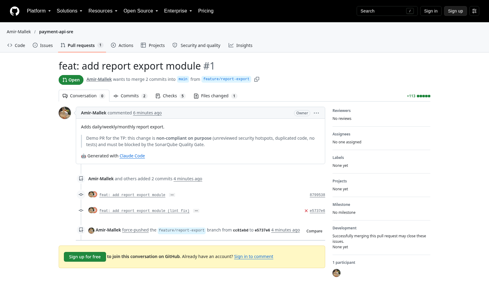
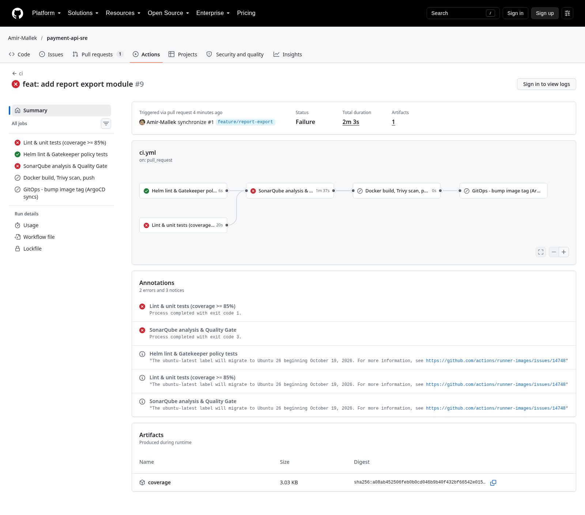
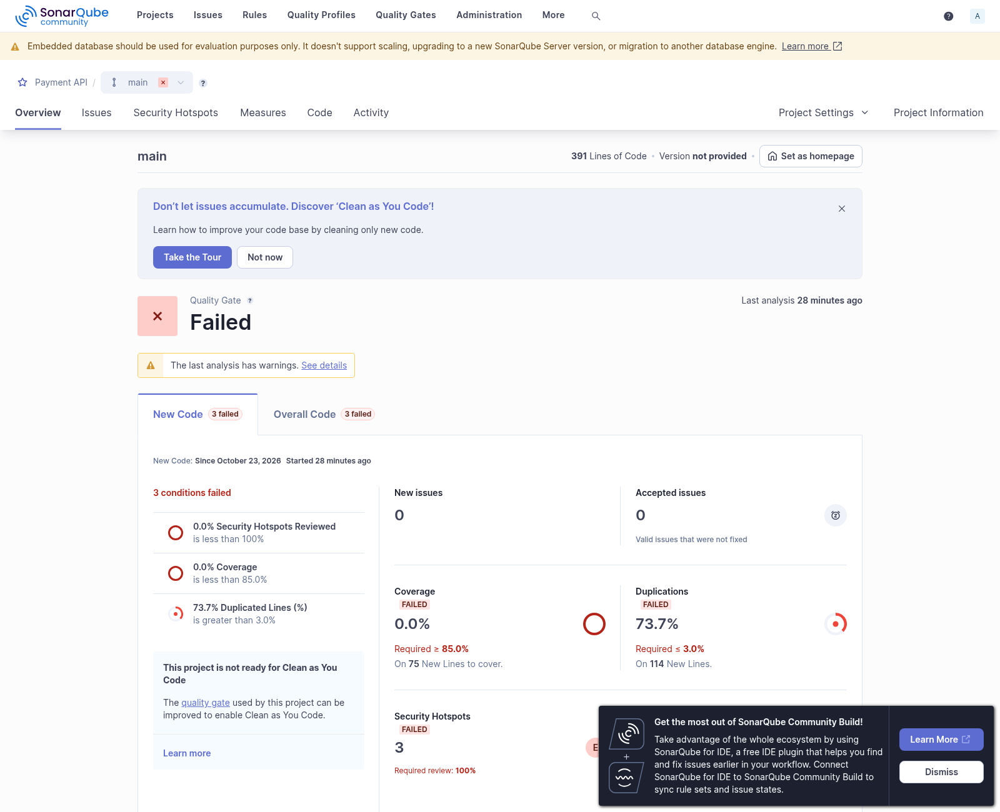
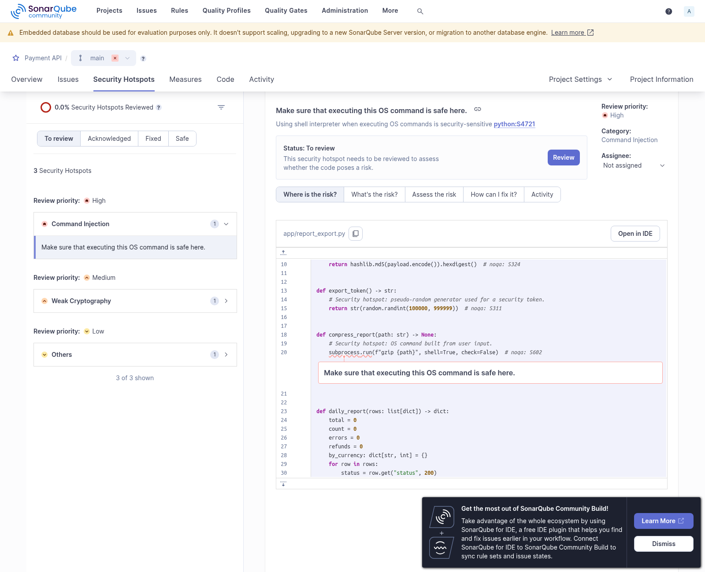
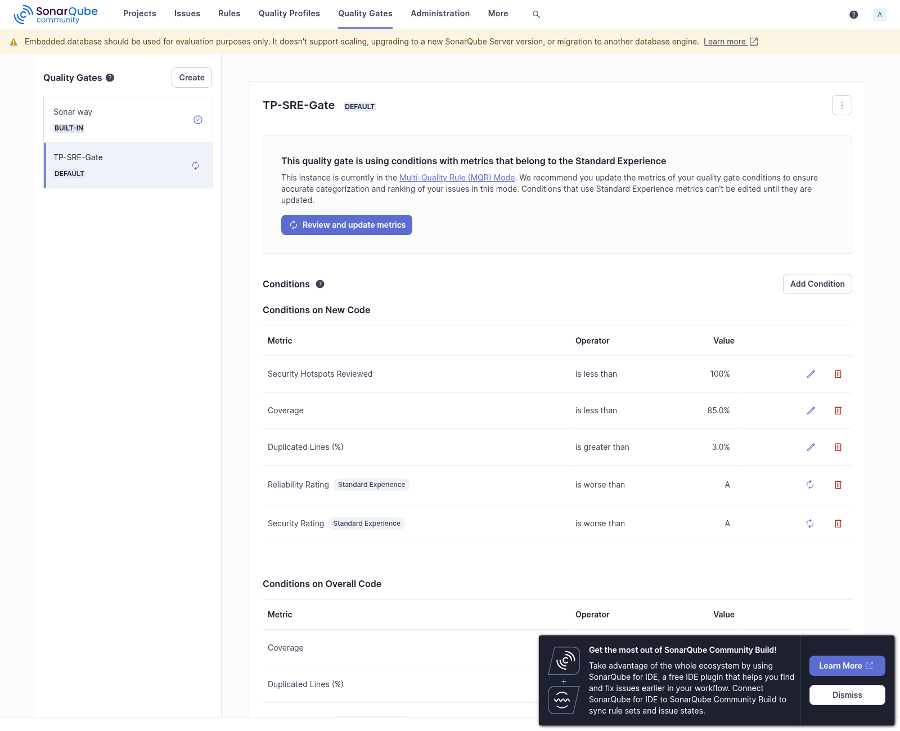

Sur `main`, le même pipeline passe entièrement (couverture 100 %, duplication 0 %, notes A, Trivy 0 CRITICAL) :

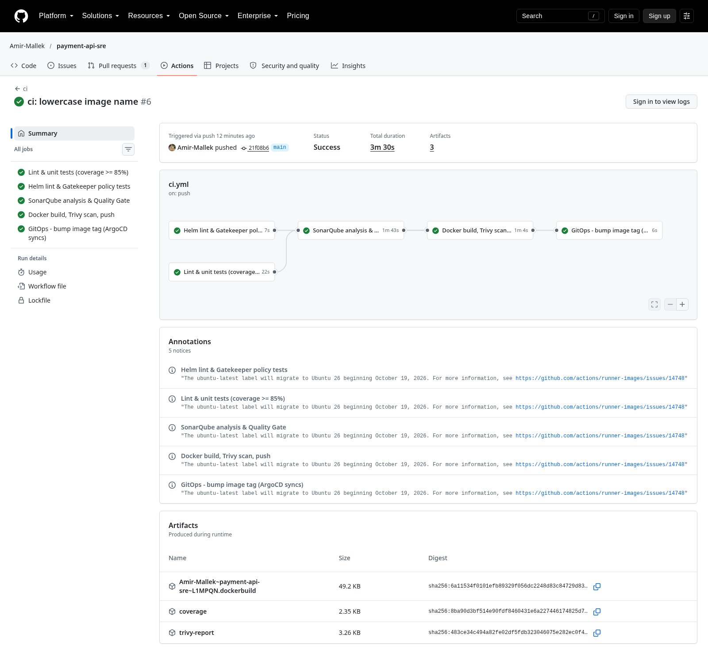

---

## 3. Policy Enforcement - OPA Gatekeeper

| ConstraintTemplate | Constraint | Règle |
|---|---|---|
| `K8sDisallowLatestTag` | `disallow-latest-tag` | refuse `:latest` **et** l'absence de tag (latest implicite), sur containers, initContainers, ephemeralContainers et pod templates (Deployment, StatefulSet, Job, CronJob...) |
| `K8sRequiredResources` | `require-requests-and-limits` | exige `requests.cpu`, `requests.memory`, `limits.cpu`, `limits.memory` sur chaque conteneur (liste paramétrable) |

Les namespaces système (`kube-system`, `gatekeeper-system`, `argocd`, `monitoring`) sont exclus.
Les politiques sont testées hors cluster par `gator verify` dans la CI (6 cas), et le chart Helm rendu est
vérifié par `gator test` avant le build.

**Rejet par l'API Server** (`docs/evidence/gatekeeper-rejections.txt`) :

```text
$ kubectl apply -f policies/tests/bad-latest-tag.yaml
Error from server (Forbidden): admission webhook "validation.gatekeeper.sh" denied the request:
[disallow-latest-tag] container <web> uses the forbidden tag 'latest' (image: nginx:latest)

$ kubectl apply -f policies/tests/bad-no-resources.yaml
Error from server (Forbidden): admission webhook "validation.gatekeeper.sh" denied the request:
[require-requests-and-limits] container <web> must define resources.limits.cpu
[require-requests-and-limits] container <web> must define resources.limits.memory
[require-requests-and-limits] container <web> must define resources.requests.cpu
[require-requests-and-limits] container <web> must define resources.requests.memory
```

**Rejet d'un déploiement ArgoCD** : l'Application `noncompliant-demo` (`deploy/noncompliant/`, image
`:latest`, sans resources) est en *Sync Failed* : le webhook Gatekeeper refuse le Deployment avec les
5 violations.

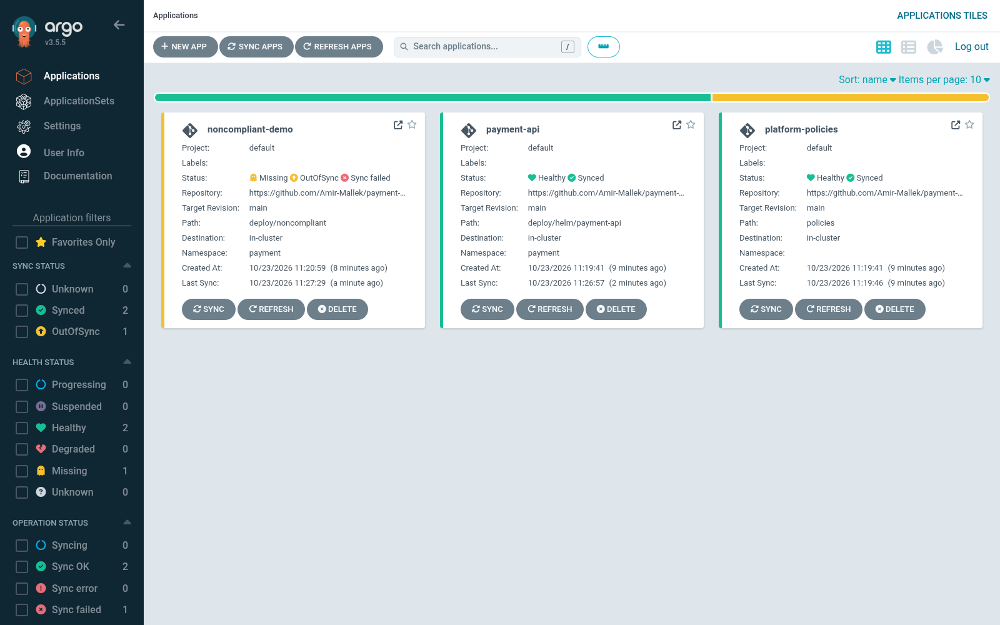
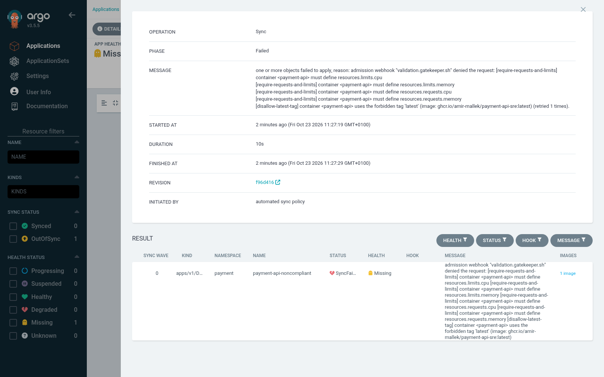

---

## 4. Chaîne CI/CD et GitOps

```
PR / push -> Lint (ruff) & pytest (cov >= 85 %) -> SonarQube + Quality Gate -> docker build
          -> Trivy (CRITICAL = exit 1) -> push ghcr.io/amir-mallek/payment-api-sre:sha-<commit>
          -> commit "deploy: payment-api sha-xxxx" dans deploy/helm/payment-api/values.yaml
          -> ArgoCD (auto-sync, prune, self-heal) -> helm -> API Server (Gatekeeper) -> pods
```

- En PR, les étapes Push et GitOps sont désactivées : seul `main` est déployé.
- Le tag d'image est toujours le SHA du commit (traçabilité, jamais `latest`).
- Trivy est exécuté depuis une image Docker épinglée (`aquasec/trivy:0.58.1`) plutôt qu'une action tierce
  à tag mobile (risque supply chain). Dernier scan : 0 CRITICAL, 7 HIGH non bloquants (dépendances Python).
- L'image est multi-stage, non-root (uid 10001), système de fichiers en lecture seule, capabilities supprimées.

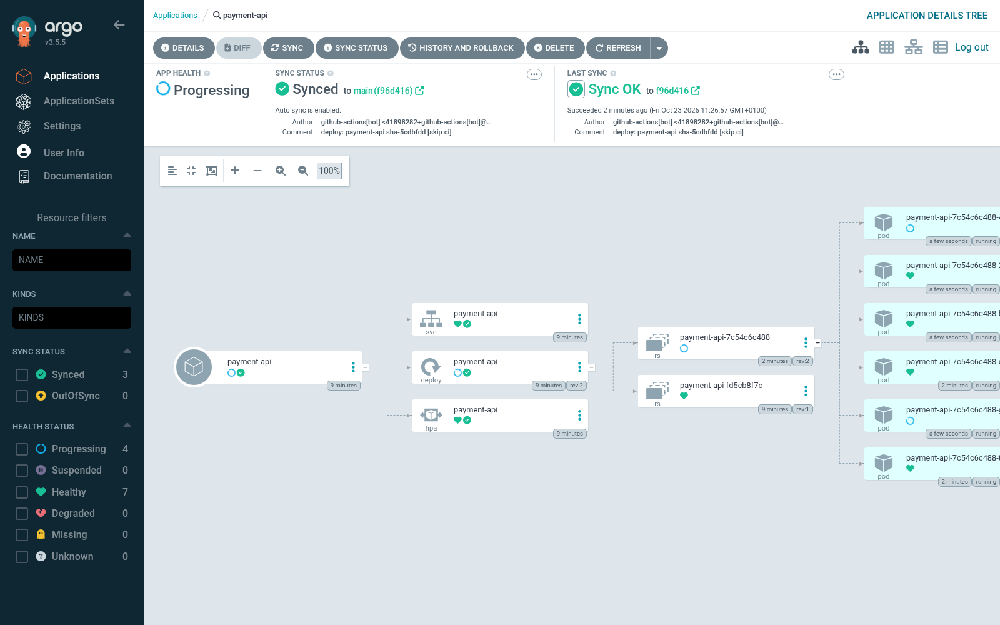

---

## 5. Observabilité

| Signal | Production | Transport | Stockage |
|---|---|---|---|
| Métriques | SDK OpenTelemetry + `PrometheusMetricReader`, endpoint `/metrics` | scrape Prometheus des pods annotés `prometheus.io/scrape` (job `kubernetes-pods`) | Prometheus |
| Traces | SDK OpenTelemetry + instrumentation FastAPI, span `checkout.process` | OTLP gRPC -> OpenTelemetry Collector (k8s attributes, **tail sampling**) | Tempo |
| Logs | JSON sur stdout avec `trace_id` / `span_id` du span courant | Grafana Alloy (API Kubernetes), labels `level`, `http_route`, `trace_id` en structured metadata | Loki |

**Corrélation** : la datasource Loki définit un *derived field* sur `"trace_id"` -> lien vers Tempo ;
la datasource Tempo définit `tracesToLogsV2` -> requête Loki `{app="payment-api"} | trace_id="<id>"`.

Métriques RED exposées par le service :
`http_server_requests_total{method, route, status_code}`,
`http_server_request_duration_seconds_bucket` (bornes incluant **0,2 s**, le seuil du SLO),
`http_server_active_requests`, `payments_processed_total{outcome}`.

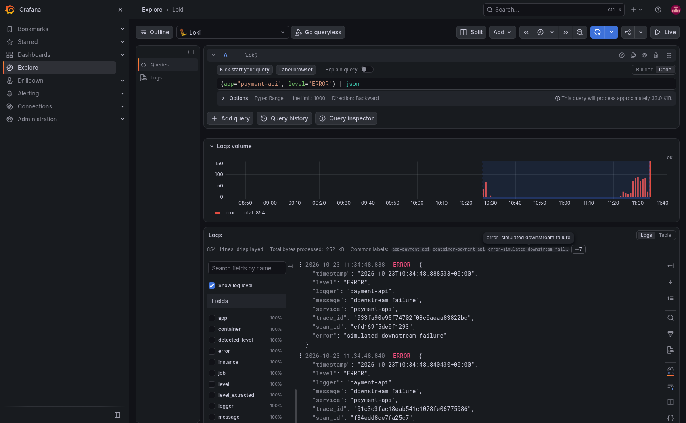

---

## 6. SLO, Error Budget et alerting

| SLO | SLI (PromQL) | Objectif | Budget sur 30 j |
|---|---|---|---|
| Disponibilité | `sum(rate(http_server_requests_total{status_code=~"5.."}[w])) / sum(rate(http_server_requests_total[w]))` | 99,5 % | 0,5 % des requêtes (= 3 h 36 min d'indisponibilité totale) |
| Latence | `1 - sum(rate(..._bucket{le="0.2"}[w])) / sum(rate(..._count[w]))` | 95 % < 200 ms | 5 % des requêtes |

Les SLI sont pré-calculés par des *recording rules* sur 5m, 30m, 1h, 6h et 30d
(`observability/rules/payment-api-slo-rules.yaml`). Burn rate = ratio d'erreur / (1 - objectif).

| Alerte | Condition | Signification | Route |
|---|---|---|---|
| `PaymentApi{Availability,Latency}BudgetBurnCritical` | burn > 14,4 sur **1 h ET 5 min**, `for: 1m` | 2 % du budget mensuel consommé en 1 h (budget épuisé en ~2 jours) | `pager` (webhook simulant PagerDuty) |
| `PaymentApi{Availability,Latency}BudgetBurnWarning` | burn > 6 sur **6 h ET 30 min**, `for: 2m` | 5 % du budget consommé en 6 h (épuisé en ~5 jours) | `slack` (Slack + webhook) |

La fenêtre longue garantit qu'un incident est significatif ; la fenêtre courte permet de lever l'alerte
rapidement une fois l'incident terminé. Une règle d'inhibition masque le warning quand le critical du même SLO
est actif.

**Dashboard Grafana `Payment API - SRE`** (provisionné par ConfigMap, généré par
`observability/dashboards/generate.py`) :
- *SLO overview* : SLI de disponibilité et de latence, **jauges d'Error Budget restant calculées sur la période
  sélectionnée** (`1 - ratio_erreurs / 0,005`), burn rate 1 h, alertes actives ;
- *Rate* : RPS par route, RPS total, requêtes en cours par pod ;
- *Errors* : erreurs/s par code HTTP, pourcentage d'erreur global avec la ligne de l'objectif 0,5 % ;
- *Duration* : p50 / p90 / p95 / p99 avec la ligne des 200 ms, p95 par route ;
- *Burn rate* : burn rate 5m / 30m / 1h / 6h avec les seuils 6 et 14,4, budget restant 30 j, logs d'erreur Loki.

---

## 7. Test de charge k6 et analyse d'incident

### 7.1 Scénarios (`k6/load-test.js`, exécuté dans le cluster par `k6/job.yaml`)

| Scénario | Profil | Durée |
|---|---|---|
| `ramp_up` | 0 -> 100 VU en 2 min, palier 2 min | 4 min 20 |
| `stress` | 0 -> 500 VU en 2 min, **palier prolongé 5 min** | 7 min 30 |
| `spike` | 0 -> **1500 VU en 10 s, maintenu 30 s** | 50 s |

Trafic : 35 % liste produits, 20 % détail (dont des 404), 20 % paiements (dont 5 % de cartes invalides -> 422),
22 % `/checkout`, 3 % `/flaky`. Les codes 4xx sont comptés comme succès (erreurs client, pas du service).
Les métriques k6 sont aussi envoyées dans Prometheus (remote write).

### 7.2 Résultats (exécution du 23/10/2026, 10:21 -> 10:35 UTC)

| Phase | Requêtes (serveur) | Taux 5xx (serveur) | p95 serveur | Requêtes < 200 ms | p95 client (k6) | Échecs client (k6) |
|---|---|---|---|---|---|---|
| ramp_up (100 VU) | 17 236 | 0,35 % | 124 ms | 99,5 % | 125 ms | 0,34 % |
| stress (500 VU) | 173 973 | 0,28 % | 124 ms | 99,6 % | 126 ms | 0,28 % |
| spike (1500 VU) | 60 812 | **0,54 %** | 186 ms | **95,8 %** | **287 ms** | **1,10 %** |
| **Total** | 262 770 | 0,37 % | | 98,6 % | 142 ms | 0,47 % |

Pic à **1 365 req/s**, HPA monté de 2 à **6 pods** (CPU à 338 % de la cible pendant le stress).

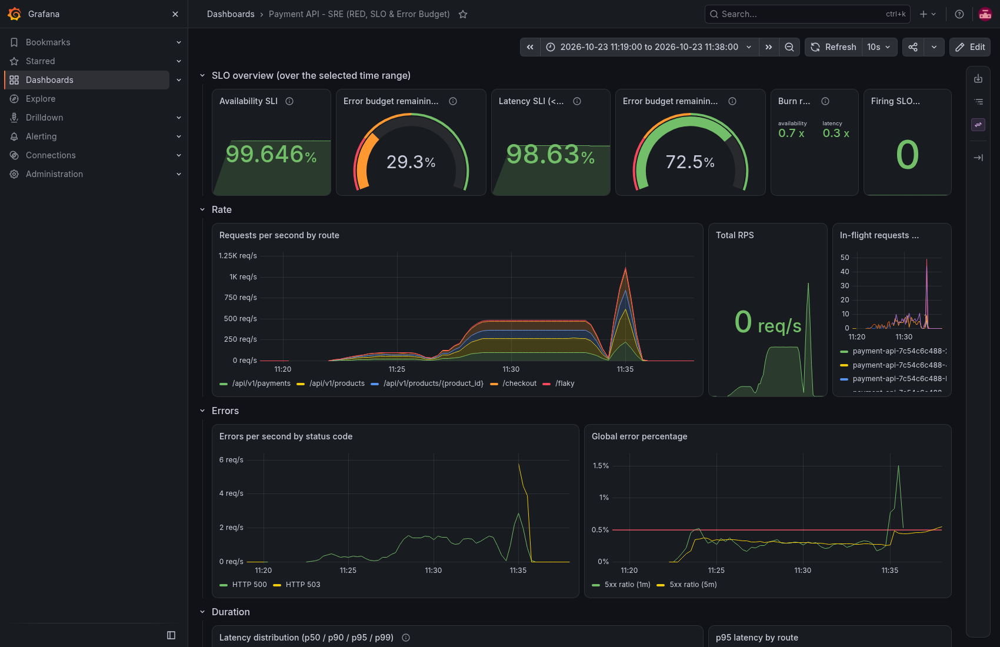
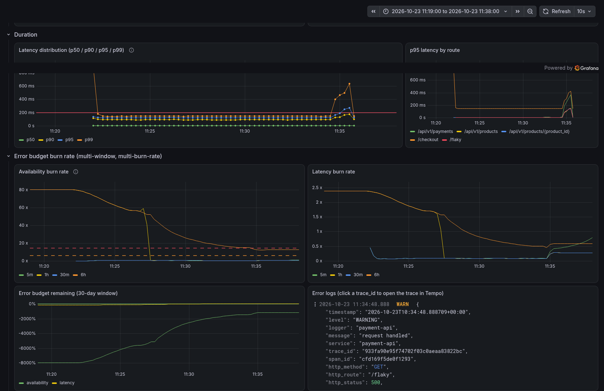

### 7.3 Analyse

1. **Ramp-up et stress respectent les deux SLO.** Le taux d'erreur résiduel (~0,3 %) vient de `/flaky`
   (10 % d'erreurs sur 3 % du trafic), soit un burn rate d'environ 0,6 : le budget est consommé moins vite que prévu.
2. **Le spike viole le SLO de disponibilité** côté serveur (0,54 % > 0,5 %) et côté client (1,1 %), et le SLO de
   latence côté client (p95 287 ms). L'HPA réagit en dizaines de secondes, le pic dure 30 s : les pods saturent
   et le **load shedding** (`MAX_IN_FLIGHT=60` par pod, réponse 503 + `Retry-After`) rejette l'excédent
   (242 réponses 503) au lieu de laisser la latence exploser pour tout le monde.
3. **Écart client / serveur.** k6 compte 1 220 échecs contre 977 réponses 5xx mesurées par le service :
   ~240 requêtes ont échoué avant d'atteindre l'application (connexions coupées pendant un rolling update
   ArgoCD survenu en cours de test, file d'attente kube-proxy). Le p95 client (287 ms) dépasse le p95 serveur
   (186 ms) pour la même raison. **Un SLI mesuré uniquement côté serveur sous-estime l'impact utilisateur.**
4. **Aucune alerte de burn rate n'a été déclenchée par ce test, et c'est le comportement attendu** :
   sur la fenêtre de 1 h, les 60 000 requêtes du spike sont noyées dans 200 000 requêtes saines
   (ratio 1 h < 7,2 %). Un pic de 30 s ne justifie pas de réveiller l'astreinte. C'est exactement le rôle de la
   fenêtre longue du multi-window multi-burn-rate.
5. **Incident secondaire sur la plateforme d'observabilité** : pendant le spike, Tempo a dépassé sa limite
   d'ingestion (15 Mo/s, `RATE_LIMITED`), a redémarré 6 fois et perdu les traces en cours.
   Correctif appliqué : **tail sampling** dans l'OpenTelemetry Collector (100 % des traces en erreur,
   100 % des traces > 200 ms, 10 % des autres) et limite mémoire de Tempo portée à 2 Gi.

### 7.4 Déclenchement de l'alerte Prometheus

__INCIDENT_SECTION__

---

## 8. Leçons et actions

| Constat | Action |
|---|---|
| L'HPA (CPU, fenêtre 15 s + délai de démarrage) est trop lent pour un spike de 30 s | `minReplicas` à 3 aux heures de pointe, HPA sur le RPS / les requêtes en cours (métrique custom), scale-up policy agressive |
| Le load shedding protège la latence mais consomme le budget de disponibilité | ajuster `MAX_IN_FLIGHT`, retries côté client avec backoff sur 503 |
| SLI serveur optimiste | ajouter un SLI côté client (k6 / synthetic monitoring, ou métriques de l'ingress) |
| Tempo saturé sous charge | tail sampling (fait), ingestion limits et stockage objet en production |
| Fenêtre 30 j peu significative sur un cluster de lab (2 h d'historique) | le panel "Error budget remaining (30-day window)" n'a de sens qu'avec un historique complet ; la jauge "sur la période" est utilisée pour l'analyse |
| Déploiement pendant un pic | geler les déploiements (ArgoCD sync windows) quand le budget est faible |
